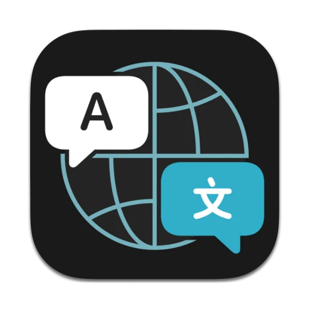

# AI Translator / AI 翻译器

<p align="center">
  
</p>

<p align="center">
  <strong>A native macOS translator with OpenAI-compatible and DeepL-compatible providers</strong><br>
  <strong>支持 OpenAI 兼容与 DeepL 兼容服务的原生 macOS 翻译工具</strong>
</p>

<p align="center">
  
  
  
  
  
</p>

---

[English](#english) | [中文](#中文)

---

## English

### 📋 Overview

AI Translator is a native macOS application for translation, polishing, and summarization. It supports OpenAI-compatible APIs and DeepL-compatible services, with provider-aware capabilities, long-text chunking, global hotkeys, language detection, history, and proxy configuration.

### ✨ Features

#### Core Capabilities
- **🌐 Translation**: Automatically detect source language and translate to your target language
- **✍️ Text Polishing**: Improve clarity, conciseness, and coherence in any language
- **📝 Summarization**: Generate concise summaries of lengthy content
- **🔄 Provider-aware Output**: OpenAI-compatible services stream with SSE; DeepL Translate and Write return complete, non-streaming responses
- **🧩 Long-text DeepL Requests**: Split oversized requests, show chunk progress, retain partial output, and retry from the failed chunk

#### Language Support
- **🔍 Multiple Detection Engines**: 
  - Local algorithm (offline)
  - Google Translate API
  - Baidu Translate API
  - Bing Translator API
- **🌍 Auto Language Detection**: Automatically identifies source language
- **↔️ Smart Language Pairing**: Intelligent source-target language suggestions
- **🔄 Language Swap**: Quick swap between source and target languages

#### User Experience
- **⌨️ Global Hotkeys**: Control the app from anywhere on your Mac
  - Show/Hide window: default ⌘⇧W
  - Toggle mode: default ⌃⌥M (local when app is focused)
  - Quick copy output: default ⌃⌥C (local when app is focused)
- **📌 Always on Top**: Pin window to stay above other applications
- **🎨 Native macOS Design**: Beautiful UI following Apple's Human Interface Guidelines
- **♿ Accessibility**: Full VoiceOver support and keyboard navigation
- **🌐 Bilingual Interface**: English and Simplified Chinese

#### Advanced Features
- **🔐 Proxy Support**: HTTP and SOCKS5 proxy with authentication
- **⚙️ Customizable Shortcuts**: Configure send key (Enter or ⌘Enter)
- **💾 Import/Export Settings & History**: Export/import preferences (JSON) and translation history (JSON)
- **🕘 History Window**: Search, filter by mode, group by date, import/export, clear
- **📊 Session State Management**: Maintains context across sessions
- **🚀 Optimized Performance**: Efficient resource usage with async/await

### 🛠 Requirements

- **macOS**: 13.0 (Ventura) or later
- **Xcode**: 15.0 or later
- **Swift**: 5.9 or later
- **One configured provider**: OpenAI-compatible, DeepL API Free/Pro, or a supported custom DeepL-compatible service

### 📦 Installation

#### From Source

1. **Clone the repository**
   ```bash
   git clone https://github.com/AlliotTech/AITranslator.git
   cd AITranslator
   ```

2. **Open in Xcode**
   ```bash
   open AITranslator.xcodeproj
   ```

3. **Build and Run**
   - Select your target device
   - Press `⌘R` or click the Run button

Optional developer tooling via `just` and `asdf`:
- Install `asdf`, then run `just setup` to install tool versions defined in `.tool-versions`
- Run `just build`, `just run`, `just lint`, or `just clean` for common tasks

### ⚙️ Configuration

#### Initial Setup

1. **Launch the application**
2. **Open Settings** (⌘,)
3. **Choose and configure a provider**:
   - **OpenAI Compatible**: translation, polishing, summarization, and SSE streaming
   - **DeepL API Free**: translation through `https://api-free.deepl.com`
   - **DeepL API Pro**: translation plus polishing through DeepL Write
   - **DLX / Custom Compatible**: choose official `/v2` or Legacy DeepLX `/translate`, then declare translation-only or translation-plus-Write capability
4. Use **Test Connection** for a DeepL provider. It sends fixed sample text, not the text in the main window.

#### DeepL Behavior and Limits

- Official translation uses `POST /v2/translate`; polishing uses `POST /v2/write/rephrase`.
- DeepL API Free does not provide DeepL Write, so polishing is disabled. DeepL-compatible providers do not provide summarization.
- Official DeepL Translate and Write are non-streaming. Results appear after each request or long-text chunk completes.
- Custom remote service URLs must use HTTPS. HTTP is accepted only for loopback hosts (`localhost`, `127.0.0.1`, and `::1`). A service root, `/v2`, complete `/v2/translate`, or complete Legacy `/translate` URL is accepted.
- The app does not silently fall back to OpenAI when a DeepL request fails.
- DLX/DeepLX is a compatibility proxy around private DeepL upstreams, not a locally hosted DeepL model. Text may still leave your machine; reliability, privacy, and terms risks depend on the deployment.
- API keys keep the existing preferences/import/export behavior. Exported preference JSON includes configured credentials.

#### Optional Settings

**General**
- App Language: System, English, or Simplified Chinese
- Detection Engine: Choose your preferred language detection method
- Default Target Language: Fallback language for translations

**Network Proxy**
- Type: None, HTTP, or SOCKS5
- Host/Port: Proxy server details
- Credentials: Username and password (optional)
- No Proxy Targets: Comma-separated bypass list

**Hotkeys**
- Show/Hide Window: Global hotkey (default: ⌘⇧W)
- Toggle Mode: Switch between Translate/Polish/Summarize (default: ⌃⌥M)
- Quick Copy: Copy output to clipboard (default: ⌃⌥C)
- Send Key: Choose Enter or ⌘Enter

### 🚀 Usage

#### Basic Workflow

1. **Enter text** in the left pane
2. **Select mode**:
   - 🌐 **Translate**: Convert text between languages
   - ✍️ **Polish**: Improve text quality in the same language
   - 📝 **Summarize**: Generate concise summaries
3. **Choose languages** (for Translate and Summarize modes)
4. **Press Send** (Enter or ⌘Enter based on your settings)
5. **View results** in the right pane. OpenAI-compatible output can stream; DeepL output arrives per completed request or chunk.

#### Keyboard Shortcuts

| Action | Shortcut |
|--------|----------|
| Send / Stop | ⏎ or ⌘⏎ (configurable) |
| Swap Languages | ⇧⌘S (in-app) |
| Copy Output | ⌘S (in-app) |
| Toggle Mode | ⌃⌥M (default, configurable) |
| Show/Hide Window | ⌘⇧W (default, configurable) |
| Settings | ⌘, |

#### Tips

- **Paste Detection**: The app automatically detects language when you paste text
- **Mode Switching**: Quickly switch between modes with the toolbar picker
- **Pin Window**: Keep the translator always visible while working
- **Export Settings**: Save your configuration for backup or sharing

### 🏗 Architecture

```
AITranslator/
├── AITranslatorApp.swift          # App entry point
├── ContentView.swift              # Main UI container
├── Models/                        # Data models
│   ├── AppLanguage.swift         # UI language settings
│   ├── KeyboardShortcut.swift    # Hotkey definitions
│   ├── Preferences.swift         # User preferences
│   └── SessionState.swift        # Translation session state
├── ViewModels/                    # Business logic
│   └── AppViewModel.swift        # Main view model
├── Views/                         # UI components
│   ├── Main/                     # Main window views
│   │   ├── TopBar.swift
│   │   ├── LeftInputPane.swift
│   │   ├── RightOutputPane.swift
│   │   └── BottomBar.swift
│   └── Settings/                 # Settings views
│       └── Sections/
│           ├── GeneralSettingsSection.swift
│           ├── APISettingsSection.swift
│           ├── ProxySettingsSection.swift
│           └── HotkeysSettingsSection.swift
├── Services/                      # Core services
│   ├── OpenAI/                   # OpenAI-compatible streaming client
│   │   ├── OpenAIClient.swift
│   │   └── SSEParser.swift
│   ├── DeepL/                    # DeepL /v2 and Legacy DeepLX client
│   │   └── DeepLClient.swift
│   ├── Detection/                # Language detection
│   │   ├── LanguageDetector.swift
│   │   └── LanguageUtils.swift
│   ├── HistoryStore.swift        # History persistence (JSON in Application Support)
│   ├── Hotkeys/                  # Global hotkey management
│   │   └── HotkeyManager.swift
│   ├── Network/                  # HTTP client with proxy
│   │   └── HTTPClient.swift
│   ├── PreferencesStore.swift    # Settings persistence
│   └── Protocols.swift           # Protocol definitions
├── Utils/                         # Utility components
│   ├── Accessibility.swift       # VoiceOver support
│   ├── Localization.swift        # i18n utilities
│   ├── Debouncer.swift          # Input debouncing
│   └── ...                       # Other utilities
└── Styles/                        # UI styling
    ├── Buttons.swift
    └── Metrics.swift
```

### 🔧 Development Setup

#### Prerequisites

Install SwiftLint for code quality:
```bash
brew install swiftlint
```

#### Building

```bash
# Build for debugging
xcodebuild -project AITranslator.xcodeproj -scheme AITranslator -configuration Debug

# Build for release
xcodebuild -project AITranslator.xcodeproj -scheme AITranslator -configuration Release
```

#### Linting

```bash
# Run SwiftLint
swiftlint

# Auto-fix issues
swiftlint --fix

# Lint specific files
swiftlint lint --path AITranslator/
```

#### Code Standards

- **Swift Style**: Follow [Swift API Design Guidelines](https://swift.org/documentation/api-design-guidelines/)
- **Line Length**: 150 characters (warning), 200 (error)
- **End of File**: All files must end with a single newline
- **No Trailing Whitespace**: Clean up whitespace on save
- **Sorted Imports**: Keep imports alphabetically sorted
- **Accessibility**: All UI elements must have proper labels

### 🧪 Testing

The `AITranslatorTests` target covers DeepL request/response contracts, language mapping, URL validation, chunking, retry behavior, compatibility decoding, provider routing, capability enforcement, and partial-output retry.

```bash
xcodebuild test -project AITranslator.xcodeproj -scheme AITranslator
```

### 🤝 Contributing

Contributions are welcome! Please follow these guidelines:

1. **Fork the repository**
2. **Create a feature branch** (`git checkout -b feature/amazing-feature`)
3. **Make your changes**
   - Follow code style guidelines
   - Add tests if applicable
   - Run SwiftLint before committing
4. **Commit your changes** (`git commit -m 'Add amazing feature'`)
5. **Push to the branch** (`git push origin feature/amazing-feature`)
6. **Open a Pull Request**

### 📝 License

This project is licensed under the MIT License - see the LICENSE file for details.

### 🙏 Acknowledgments

- OpenAI for the API
- Apple for SwiftUI and excellent development tools
- All contributors and users

### 📧 Contact

For questions or support, please open an issue on GitHub.

---

## 中文

### 📋 项目概述

AI Translator 是一款原生 macOS 应用，支持 OpenAI 兼容 API 与 DeepL 兼容服务，可完成翻译、文本润色和内容摘要，并提供长文本分块、全局快捷键、语言检测、历史记录与代理配置。

### ✨ 功能特性

#### 核心功能
- **🌐 翻译**：自动检测源语言并翻译到目标语言
- **✍️ 文本润色**：提升任何语言的文本清晰度、简洁性和连贯性
- **📝 内容摘要**：为冗长内容生成简洁摘要
- **🔄 按服务输出**：OpenAI 兼容服务通过 SSE 流式输出；DeepL Translate 和 Write 返回完整的非流式响应
- **🧩 DeepL 长文本处理**：自动按请求体限制分块，显示分块进度，失败时保留部分结果并从失败块重试

#### 语言支持
- **🔍 多种检测引擎**：
  - 本地算法（离线）
  - Google 翻译 API
  - 百度翻译 API
  - 必应翻译 API
- **🌍 自动语言检测**：自动识别源语言
- **↔️ 智能语言配对**：智能的源语言-目标语言建议
- **🔄 语言互换**：快速交换源语言和目标语言

#### 用户体验
- **⌨️ 全局快捷键**：在 Mac 上的任何位置控制应用
  - 显示/隐藏窗口：默认 ⌘⇧W
  - 切换模式：默认 ⌃⌥M（应用在前台时生效）
  - 快速复制输出：默认 ⌃⌥C（应用在前台时生效）
- **📌 窗口置顶**：固定窗口保持在其他应用程序之上
- **🎨 原生 macOS 设计**：遵循 Apple 人机界面指南的精美 UI
- **♿ 无障碍访问**：完整的 VoiceOver 支持和键盘导航
- **🌐 双语界面**：英语和简体中文

#### 高级特性
- **🔐 代理支持**：支持 HTTP 和 SOCKS5 代理及身份验证
- **⚙️ 可自定义快捷键**：配置发送键（回车或 ⌘回车）
- **💾 导入/导出（设置与历史）**：导出/导入偏好设置（JSON）与翻译历史（JSON）
- **🕘 历史记录窗口**：搜索、按模式筛选、按日期分组、导入/导出、清空
- **📊 会话状态管理**：在会话间保持上下文
- **🚀 性能优化**：使用 async/await 的高效资源利用

### 🛠 系统要求

- **macOS**: 13.0 (Ventura) 或更高版本
- **Xcode**: 15.0 或更高版本
- **Swift**: 5.9 或更高版本
- **至少配置一种服务**：OpenAI 兼容、DeepL API Free/Pro，或受支持的自定义 DeepL 兼容服务

### 📦 安装

#### 从源代码构建

1. **克隆仓库**
   ```bash
   git clone https://github.com/yourusername/AITranslator.git
   cd AITranslator
   ```

2. **在 Xcode 中打开**
   ```bash
   open AITranslator.xcodeproj
   ```

3. **构建并运行**
   - 选择目标设备
   - 按 `⌘R` 或点击运行按钮

可选开发工具（`just` + `asdf`）：
- 安装 `asdf` 后运行 `just setup`，根据 `.tool-versions` 安装工具版本
- 使用 `just build`、`just run`、`just lint`、`just clean` 执行常用任务

### ⚙️ 配置

#### 初始设置

1. **启动应用程序**
2. **打开设置** (⌘,)
3. **选择并配置服务**：
   - **OpenAI 兼容**：支持翻译、润色、总结与 SSE 流式输出
   - **DeepL API Free**：通过 `https://api-free.deepl.com` 翻译
   - **DeepL API Pro**：支持翻译，并通过 DeepL Write 润色
   - **DLX / 自定义兼容服务**：明确选择官方 `/v2` 或 Legacy DeepLX `/translate` 协议，并声明仅翻译或翻译 + Write
4. DeepL 服务可使用“测试连接”。测试只发送固定样例文本，不会使用主窗口内容。

#### DeepL 行为与限制

- 官方翻译调用 `POST /v2/translate`；润色调用 `POST /v2/write/rephrase`。
- DeepL API Free 不支持 DeepL Write，因此润色会禁用；DeepL 兼容服务均不支持总结。
- 官方 DeepL Translate 和 Write 都是非流式接口。短文本在请求完成后展示，长文本按分块完成逐步展示。
- 自定义远程服务必须使用 HTTPS；只有回环地址（`localhost`、`127.0.0.1`、`::1`）允许 HTTP。可以填写服务根地址、`/v2`、完整 `/v2/translate` 或完整 Legacy `/translate` 地址。
- DeepL 请求失败时不会静默回退到 OpenAI。
- DLX/DeepLX 是调用 DeepL 私有上游的兼容代理，不是本地部署的 DeepL 模型。文本仍可能离开本机，稳定性、隐私与服务条款风险取决于所选部署。
- API 密钥继续沿用应用现有的偏好设置与导入导出行为；导出的设置 JSON 会包含已配置凭据。

#### 可选设置

**通用**
- 软件语言：系统、英语或简体中文
- 检测引擎：选择您偏好的语言检测方法
- 默认目标语言：翻译的后备语言

**网络代理**
- 类型：不使用、HTTP 或 SOCKS5
- 主机/端口：代理服务器详情
- 凭据：用户名和密码（可选）
- 代理排除目标：逗号分隔的绕过列表

**快捷键**
- 显示/隐藏窗口：全局快捷键（默认：⌘⇧W）
- 切换模式：在翻译/润色/总结之间切换（默认：⌃⌥M）
- 快速复制：复制输出到剪贴板（默认：⌃⌥C）
- 发送键：选择回车或 ⌘回车

### 🚀 使用方法

#### 基本工作流程

1. **在左侧面板输入文本**
2. **选择模式**：
   - 🌐 **翻译**：在语言间转换文本
   - ✍️ **润色**：改善同一语言的文本质量
   - 📝 **摘要**：生成简洁摘要
3. **选择语言**（翻译和摘要模式）
4. **按发送**（根据设置为回车或 ⌘回车）
5. **查看结果**：OpenAI 兼容服务可流式显示；DeepL 按完整请求或分块完成后显示

#### 键盘快捷键

| 操作 | 快捷键 |
|------|--------|
| 发送/停止 | ⏎ 或 ⌘⏎（可配置）|
| 交换语言 | ⇧⌘S（应用内）|
| 复制输出 | ⌘S（应用内）|
| 切换模式 | ⌃⌥M（默认，可配置）|
| 显示/隐藏窗口 | ⌘⇧W（默认，可配置）|
| 设置 | ⌘, |

#### 使用技巧

- **粘贴检测**：粘贴文本时应用会自动检测语言
- **模式切换**：使用工具栏选择器快速切换模式
- **固定窗口**：工作时保持翻译器始终可见
- **导出设置**：保存配置以备份或共享

### 🏗 架构

```
AITranslator/
├── AITranslatorApp.swift          # 应用入口点
├── ContentView.swift              # 主 UI 容器
├── Models/                        # 数据模型
│   ├── AppLanguage.swift         # UI 语言设置
│   ├── KeyboardShortcut.swift    # 快捷键定义
│   ├── Preferences.swift         # 用户偏好设置
│   └── SessionState.swift        # 翻译会话状态
├── ViewModels/                    # 业务逻辑
│   └── AppViewModel.swift        # 主视图模型
├── Views/                         # UI 组件
│   ├── Main/                     # 主窗口视图
│   │   ├── TopBar.swift
│   │   ├── LeftInputPane.swift
│   │   ├── RightOutputPane.swift
│   │   └── BottomBar.swift
│   └── Settings/                 # 设置视图
│       └── Sections/
│           ├── GeneralSettingsSection.swift
│           ├── APISettingsSection.swift
│           ├── ProxySettingsSection.swift
│           └── HotkeysSettingsSection.swift
├── Services/                      # 核心服务
│   ├── OpenAI/                   # OpenAI 兼容流式客户端
│   │   ├── OpenAIClient.swift
│   │   └── SSEParser.swift
│   ├── DeepL/                    # DeepL /v2 与 Legacy DeepLX 客户端
│   │   └── DeepLClient.swift
│   ├── Detection/                # 语言检测
│   │   ├── LanguageDetector.swift
│   │   └── LanguageUtils.swift
│   ├── HistoryStore.swift        # 历史记录持久化（应用支持目录中的 JSON）
│   ├── Hotkeys/                  # 全局快捷键管理
│   │   └── HotkeyManager.swift
│   ├── Network/                  # 带代理的 HTTP 客户端
│   │   └── HTTPClient.swift
│   ├── PreferencesStore.swift    # 设置持久化
│   └── Protocols.swift           # 协议定义
├── Utils/                         # 实用工具组件
│   ├── Accessibility.swift       # VoiceOver 支持
│   ├── Localization.swift        # 国际化工具
│   ├── Debouncer.swift          # 输入防抖
│   └── ...                       # 其他工具
└── Styles/                        # UI 样式
    ├── Buttons.swift
    └── Metrics.swift
```

### 🔧 开发设置

#### 前置要求

安装 SwiftLint 以确保代码质量：
```bash
brew install swiftlint
```

#### 构建

```bash
# 调试构建
xcodebuild -project AITranslator.xcodeproj -scheme AITranslator -configuration Debug

# 发布构建
xcodebuild -project AITranslator.xcodeproj -scheme AITranslator -configuration Release
```

#### 代码检查

```bash
# 运行 SwiftLint
swiftlint

# 自动修复问题
swiftlint --fix

# 检查特定文件
swiftlint lint --path AITranslator/
```

#### 代码规范

- **Swift 风格**：遵循 [Swift API 设计指南](https://swift.org/documentation/api-design-guidelines/)
- **行长度**：150 字符（警告），200（错误）
- **文件结尾**：所有文件必须以单个换行符结束
- **无尾随空格**：保存时清理空格
- **导入排序**：保持导入按字母顺序排列
- **无障碍访问**：所有 UI 元素必须有适当的标签

### 🧪 测试

`AITranslatorTests` 测试目标覆盖 DeepL 请求与响应协议、语言映射、URL 校验、长文本分块、重试策略、旧数据兼容解码、服务路由、能力限制以及部分结果续传。

```bash
xcodebuild test -project AITranslator.xcodeproj -scheme AITranslator
```

### 🤝 贡献

欢迎贡献！请遵循以下指南：

1. **Fork 仓库**
2. **创建功能分支** (`git checkout -b feature/amazing-feature`)
3. **进行更改**
   - 遵循代码风格指南
   - 如适用，添加测试
   - 提交前运行 SwiftLint
4. **提交更改** (`git commit -m 'Add amazing feature'`)
5. **推送到分支** (`git push origin feature/amazing-feature`)
6. **打开 Pull Request**

### 📝 许可证

本项目采用 MIT 许可证 - 详见 LICENSE 文件。

### 🙏 致谢

- OpenAI 提供的 API
- Apple 提供的 SwiftUI 和优秀的开发工具
- 所有贡献者和用户

### 📧 联系方式

如有问题或需要支持，请在 GitHub 上提出 issue。

---

<p align="center">Made with ❤️ for the macOS community</p>
